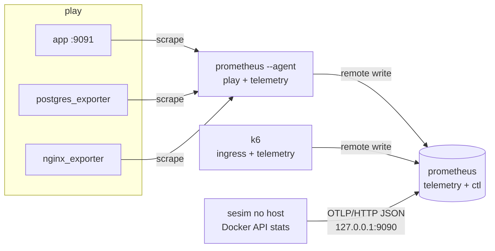

# ADR-0014: Topologia de telemetria — agente de coleta, redes separadas e stats de containers pelo host

**Status:** Proposto
**Data:** 2026-09-25
**Decisores:** Lucas Zanetti
**Refina:** ADR-0013 (a zona "observadora" passa a ter duas redes) e ADR-0007

## Contexto

O Chunk 5 precisa juntar, na mesma janela de tempo, quatro sinais de origens diferentes:

| Sinal | Origem | Onde está |
|---|---|---|
| Latência vista pelo cliente | k6 | zona observadora |
| CPU/memória/throttling por container | cgroups, via Docker Engine API | host |
| Pool de conexões do app | `/metrics` do app (porta 9091) | rede `play` |
| Custo por query, conexões, locks | `pg_stat_statements` via postgres_exporter | rede `play` |

Restrições:

1. **T12 (threat model):** nada controlado pelo jogador pode escrever no Prometheus.
2. Revisando o compose do Chunk 3, achei uma falha: o **nginx fica na rede `obs`**, e a configuração dele é do jogador. Se o Prometheus (com receptor de remote write) entrar nessa rede, um `proxy_pass http://prometheus:9090` no nginx basta para injetar métricas.
3. **T6:** nenhum container recebe o socket Docker. Isso exclui o cAdvisor na configuração usual, que monta `/var/run` (e com ele o socket), `/var/lib/docker` e em geral roda privilegiado.
4. Sem dependência nova sem justificativa. O sesim não deve ganhar uma porta extra escutando em interfaces de bridge.

## Decisão

### Redes (substitui a rede única `obs`)

| Rede | `internal` | Membros | Propósito |
|---|---|---|---|
| `play` | sim | nginx, app×N, postgres, toolbox, payments, exporters, **agente** | sistema do jogador |
| `ingress` | sim | nginx, k6 | só a entrada do tráfego de carga |
| `telemetry` | sim | prometheus, agente, k6 | escrita de métricas |
| `ctl` (só dev) | não | prometheus | publica `127.0.0.1:9090` para o host |

Nenhum container da rede `play` está na `telemetry`, exceto o agente, que é imagem nossa, não configurada pelo jogador e sem receptor de escrita.

### Coleta

- **Agente de coleta:** Prometheus em `--agent` nas redes `play` e `telemetry`. Faz o scrape de tudo que mora na `play` (app via DNS, o que já cobre N réplicas; exporters) e envia por remote write ao Prometheus principal.
- **k6:** `-o experimental-prometheus-rw` (nome confirmado no k6 2.3.0; `prometheus-rw` não existe).
- **Stats de containers:** o processo do sesim no host, o único cliente Docker (ADR-0005), lê `GET /containers/{id}/stats` (one-shot) e `inspect` (quota atual, que muda com `docker update`) e envia via **receptor OTLP do Prometheus em JSON**. Testado no Prometheus 3.14.0: HTTP 200 e série consultável com os atributos viram labels. Só stdlib, sem protobuf.
- **Métricas de throttling do CFS** (`throttled_periods`, `throttled_time`) entram na coleta porque são a causa do ruído medido no Chunk 3.

## Opções consideradas

| Opção | Segurança (T6/T12) | Dependências | Observação |
|---|---|---|---|
| **Agente + redes separadas + host via OTLP JSON** | Atende | 0 novas no binário (moby já previsto) | Mais containers (agente) |
| Prometheus também na rede `play` | Viola T12 | 0 | Rejeitada |
| cAdvisor para stats de containers | Viola T6 (socket/privileged) | imagem extra | Rejeitada |
| sesim expõe `/metrics` no IP do gateway da bridge | Atende com cuidado | 0 | Abre uma porta do sesim numa interface de bridge; isolamento depende de regras de firewall do Docker; não funciona no Docker Desktop |
| sesim envia remote write (protobuf + snappy) | Atende | `prompb`, snappy | OTLP JSON faz o mesmo sem dependência |

## Consequências

- **Latência do k6 como histograma nativo** (`K6_FEATURES=native-histograms`, Chunk 7). As séries de trend stats (`k6_http_req_duration_p95`) são cumulativas desde o início de cada execução do k6, e num tráfego de fundo de horas escondiam a recuperação (p95 de 4,98 s parado enquanto a requisição real levava 1 ms). Com o histograma, o p95 por janela é `histogram_quantile` e soma as séries de status HTTP corretamente.
- Nomes preservados na tradução OTLP → Prometheus 3.14.0 (`sesim_container_cpu_usage_seconds_total` continua igual). A duração no remote write do k6 é em **segundos**.
- O jogador vê métricas de container com o prefixo `sesim_container_*`: medidas pelo host, confiáveis para o evaluator (dimensão `resources`).
- O acesso ao Prometheus a partir do host no dev usa `127.0.0.1:9090` (rede `ctl`). Na sandbox real, o `SandboxDriver.Endpoint` resolve isso (Chunk 8).
- O receptor OTLP é descrito como "não indicado para alto volume". Nosso volume é de ~10 containers × ~10 séries a cada 1–2 s, muito abaixo disso.
- Se o Prometheus mudar a tradução de nomes OTLP → Prometheus, os nomes das séries mudam. Por isso eles ficam fixados num teste de integração (`just dev-telemetry-check`).

## Ações

1. [x] Validar o OTLP JSON e o nome da saída do k6 empiricamente (2026-09-25).
2. [x] RAM durante o Flash Sale (2026-09-25): Prometheus 67 MiB, agente 47 MiB, stack inteiro 390 MiB.
3. [x] Isolamento verificado por `just dev-telemetry-check`: toolbox, nginx e app não alcançam o Prometheus; o agente alcança.

## Fontes

- Receptores OTLP e remote write: https://prometheus.io/docs/prometheus/latest/querying/api
- Modo agente: https://prometheus.io/docs/prometheus/latest/prometheus_agent
- Saída remote write do k6: https://grafana.com/docs/k6/latest/results-output/real-time/prometheus-remote-write
- Tipos de stats do Docker: `go doc github.com/moby/moby/api/types/container.StatsResponse` (moby/moby/api v1.56.0)
