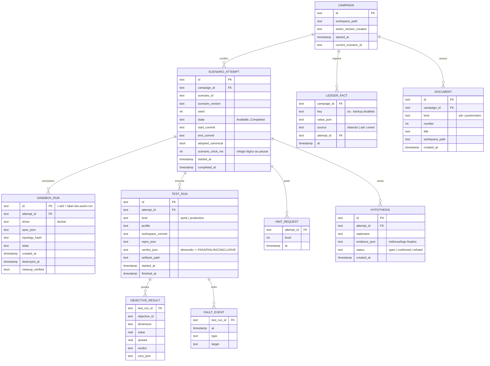

# Modelo de Dados

> Status: Chunk 1, proposta. Persistência: ADR-0012. O esquema SQL definitivo nasce nas migrações do Chunk 6+.

## 1. Onde cada coisa mora

| Dado | Onde | Por quê |
|---|---|---|
| Campanha, tentativas, testes, resultados, ledger, dicas, hipóteses | SQLite `$XDG_DATA_HOME/sesim/sesim.db` | Consultas relacionais, transações, arquivo único |
| Eventos de produto | JSONL `$XDG_DATA_HOME/sesim/events/YYYY-MM.jsonl` | Append-only, fácil de inspecionar e exportar (opt-in) |
| Artefatos de teste (resumo k6, séries exportadas, logs) | `$XDG_DATA_HOME/sesim/runs/<test_id>/` | Grandes demais e sem valor relacional |
| Cache de snapshots do Postgres e do Go build | `$XDG_CACHE_HOME/sesim/` | Pode ser apagado sem perda |
| Código do jogador, topologia, ADRs, postmortems | **Workspace** (repo git, pasta escolhida pelo jogador) | É o artefato do jogador; versionado por ele |
| Pacotes de cenário oficiais | Embutidos no binário (`embed.FS`) | Versão atrelada à versão do sesim |

Em macOS/Windows, usar os diretórios equivalentes do SO (`os.UserConfigDir`/`os.UserCacheDir`).

## 2. Entidades



Notas:

- `DOCUMENT` guarda só o índice. O conteúdo é Markdown no workspace (`docs/adr/`, `docs/postmortems/`), versionado pelo git do jogador.
- `LEDGER_FACT` é append-only; o valor vigente é o mais recente por `key`. Mantém o histórico de "quando você decidiu isso".
- IDs são ULID (ordenáveis por tempo, sem coordenação).
- Não há tabela de usuário: local-first, um jogador por instalação. Várias campanhas por instalação são permitidas.

## 3. Evento de produto (JSONL)

```json
{"v":1,"ts":"2026-09-24T18:03:11Z","event":"hint_requested","install_id":"i-01J…","campaign_id":"c-01J…","scenario":"stage1/c1-slow-search@1.0.0","props":{"level":2}}
```

- `install_id` é aleatório, gerado localmente, sem vínculo com identidade.
- Nunca: conteúdo de código, SQL digitado, texto de hipótese, caminhos do disco, e-mail.
- Catálogo de eventos em [`observability.md`](observability.md) §4.

## 4. Migrações e compatibilidade

- Migrações SQL numeradas e embutidas; aplicadas no start; sem downgrade automático.
- `scenario_version` fica gravado em cada tentativa. Uma nova versão do sesim com versão nova de um cenário **não** altera tentativas concluídas. Tentativas em andamento continuam na versão com que começaram, se ela ainda estiver embutida; se não, o jogador é avisado e pode reiniciar a tentativa.
