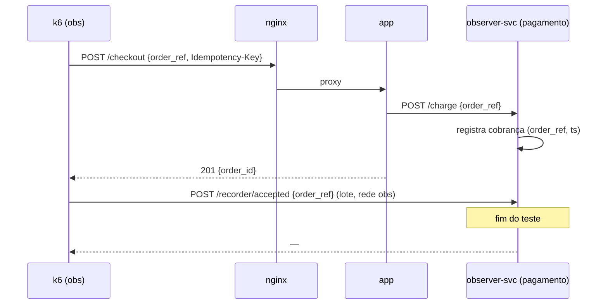
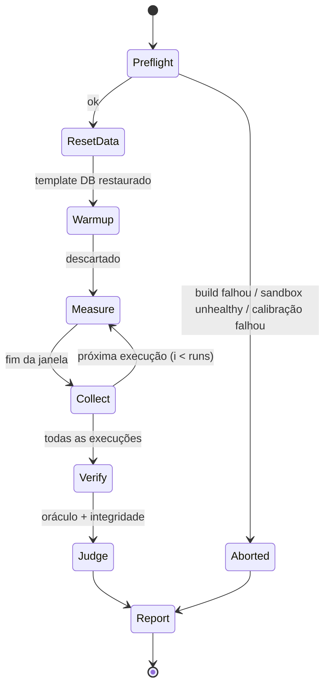

# Evaluator

> Status: Chunk 1, proposta. Formato dos objetivos: ADR-0010. Zonas de medição: ADR-0013.

## 1. Requisitos

1. Avaliar **propriedades mensuráveis**, nunca a presença de tecnologias.
2. Resultado **por dimensão** (corretude, latência, disponibilidade, integridade, recursos, custo), sem nota única.
3. **Honesto sobre incerteza:** INCONCLUSIVE é um resultado válido e preferível a um PASS/FAIL falso.
4. **Não confiar no sistema avaliado:** as medições vêm de fora da zona do jogador.
5. **Reproduzível e auditável:** todo relatório guarda os valores brutos e a tupla de reprodutibilidade.

## 2. Fontes de medição

| Fonte | O que mede | Zona | Pode ser adulterada pelo jogador? |
|---|---|---|---|
| `k6` | Latência e erros **vistos pelo cliente**; `dropped_iterations` | observadora | Não |
| `observer-svc` | Cobranças recebidas por `order_ref` (duplicidade); refs aceitos reportados pelo k6 (perda) | observadora | Não |
| `oracle` | Respostas de endpoints para casos conhecidos vs. esperado | executado pelo sesim via nginx | Não (a resposta é o que está sendo testado) |
| `container` | CPU/memória por componente em relação à quota (stats do Docker/cAdvisor) | host / daemon | Não |
| `promql` | Métricas do postgres_exporter e do nginx | observadora (scrape) | Parcialmente: o jogador controla a config do nginx e o Postgres. Só vale para dimensão `resources` |
| `sql` (probe) | Estado do banco via `sesim_observer`, somente leitura | via rede play | Parcialmente: dados podem ser forjados. Usado para *integridade cruzada*, nunca sozinho |
| `topology` | Componentes, réplicas, tamanhos | arquivo validado | Sim, mas só alimenta `cost` e `complexity`, nunca aprovação técnica |
| Métricas expostas pelo **app** | — | play | **Sim → nunca usadas em objetivos.** Só aparecem no dashboard como sinal para investigação |

### Integridade de pedidos (C2/C3)



- **Pagamento duplicado** = `order_ref` com mais de uma cobrança no observer-svc.
- **Pedido perdido** = `order_ref` aceito (2xx para o k6) sem cobrança **ou** sem linha em `orders`, conferido com o probe SQL. O probe sozinho não basta, mas a cobrança sozinha também não; a combinação reduz o espaço de fraude.
- O `order_ref` faz parte do **contrato da API v1** da Nexora (documentado no workspace). Quebrar o contrato falha o oráculo.

## 3. Ciclo de vida da avaliação



| Etapa | O que acontece |
|---|---|
| Preflight | Commit de checkpoint do workspace; build; sandbox healthy; calibração; oráculo *smoke* (1 caso) para falhar rápido em contrato quebrado |
| ResetData | Mesma base inicial para toda execução (template DB). Sem isso, cada execução mede um banco diferente |
| Warmup | Tráfego do perfil por `warmup`; métricas descartadas (JIT, caches frios, pool) |
| Measure | Perfil + timeline de falhas; início e fim marcados para as consultas |
| Collect | Resumo do k6 (JSON), consultas PromQL na janela, stats de containers, registros do observer-svc |
| Verify | Oráculo completo, integridade de pedidos |
| Judge | Estatística e regras de veredito (§4) |
| Report | Persistido no SQLite + JSON em disco; evento `test_passed`/`test_failed` |

**Nota:** o reset de dados entre execuções desfaz índices criados *via psql* que não estejam no workspace. Isso é proposital, porque obriga a mudança a ser **código ou migração versionada**, como em produção. O briefing e a dica de nível 3 do C1 deixam isso claro. Mecanismo: migrações do workspace (`nexora/migrations/`) são aplicadas no início de cada execução.

## 4. Estatística e regras de veredito

Para cada medição *m* com *R* execuções (`runs`, padrão 3):

- **valor** = mediana das R execuções;
- **dispersão** = (máx − mín) / mediana.

Para um objetivo `m < L` com margem relativa `δ` (padrão 10 %):

| Condição | Veredito |
|---|---|
| todas as execuções `< L·(1−δ)` | **PASS** |
| todas as execuções `> L·(1+δ)` | **FAIL** |
| qualquer outro caso, ou dispersão > 25 %, ou `dropped_iterations > 0` | **INCONCLUSIVE** |

- INCONCLUSIVE mostra o motivo ("seu p95 ficou entre 272 e 331 ms; o limiar é 300 ms") e sugere rodar de novo ou investigar a variação. **Para a campanha, INCONCLUSIVE não conta como PASS.**
- Objetivos booleanos (corretude, integridade) não têm margem: qualquer violação é FAIL.
- Os números acima (3 execuções, 10 %, 25 %) são **ponto de partida** a validar pela H5 no Chunk 6.
- O autor do cenário é obrigado (linter + harness) a manter o estado quebrado e as referências longe do limiar. Essa é a principal proteção contra ruído, mais importante que a estatística.

## 5. Dimensões

| Dimensão | Exemplos de medição | Fonte típica |
|---|---|---|
| `correctness` | razão de acertos do oráculo | oracle |
| `latency` | p50/p95/p99 por endpoint | k6 |
| `availability` | taxa de sucesso por janela; maior janela contínua de indisponibilidade | k6 |
| `integrity` | pedidos perdidos, pagamentos duplicados | observer-svc + probe |
| `resources` | CPU/mem em relação à quota; conexões em relação a `max_connections` | container, promql |
| `cost` | custo mensal **modelado** a partir da topologia | topology + tabela de preços do cenário |
| `complexity` (futuro) | nº de componentes, dependências, superfície de falha | topology |

Cada dimensão leva um selo de proveniência na UI: `medido` ou `modelado`.

## 6. Relatório

```json
{
  "test_id": "t-01J…",
  "kind": "production",
  "scenario": { "id": "stage1/c1-slow-search", "version": "1.0.0", "seed": 4242 },
  "repro": { "workspace_commit": "…", "topology_hash": "…", "images": ["…@sha256:…"], "sesim": "0.1.0",
             "calibration": { "cores": 8, "quota_delivered": 0.98, "os": "linux", "arch": "amd64" } },
  "runs": [ { "i": 1, "window": ["…", "…"], "values": { "p95_ms": 212.4, "error_rate": 0.0011 } } ],
  "objectives": [
    { "id": "search-latency", "dimension": "latency", "expr": "p95_ms < 300",
      "value": 214.9, "spread": 0.06, "verdict": "PASS" }
  ],
  "faults": [ { "at": "…", "type": "kill", "target": "app#1" } ],
  "verdict": { "correctness": "PASS", "latency": "PASS", "availability": "PASS", "resources": "FAIL" }
}
```

Os valores acima são um exemplo de formato, não uma medição.

## 7. Debrief a partir do relatório

- **Antes/depois:** o primeiro Production Test com FAIL comparado ao PASS.
- **Soluções de referência:** os valores das referências vêm do harness (`simulation-engine.md` §8), rodado no CI e embutido no pacote, e aparecem num gráfico de dispersão *latência × custo × componentes* ao estilo Opus Magnum. O selo explica que foram medidos no ambiente de referência, não na máquina do jogador.

## 8. Anti-trapaça (escopo real)

| Ataque | Local (MVP) | Defesa |
|---|---|---|
| Resposta fixa / cache fora do contrato | possível | Oráculo com casos gerados pela seed, incluindo dados escritos durante o teste (ex.: produto criado → aparece na busca) |
| Pular a escrita do pedido | possível | Integridade cruzada (observer-svc + probe) |
| Detectar o gerador de carga | possível | User-agent e padrões iguais ao do tráfego de fundo; sem cabeçalho especial |
| Editar o relatório/SQLite | trivial localmente | **Aceito no MVP.** Sem leaderboard, só o próprio jogador se engana. No modo hospedado, o evaluator roda fora da máquina do jogador |
