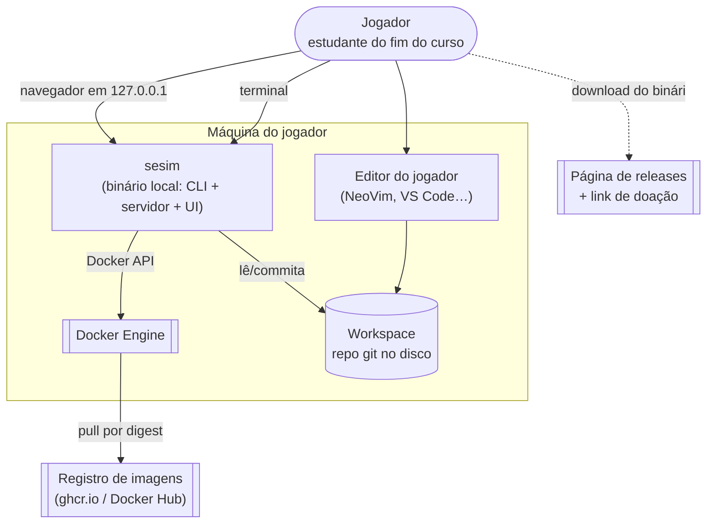
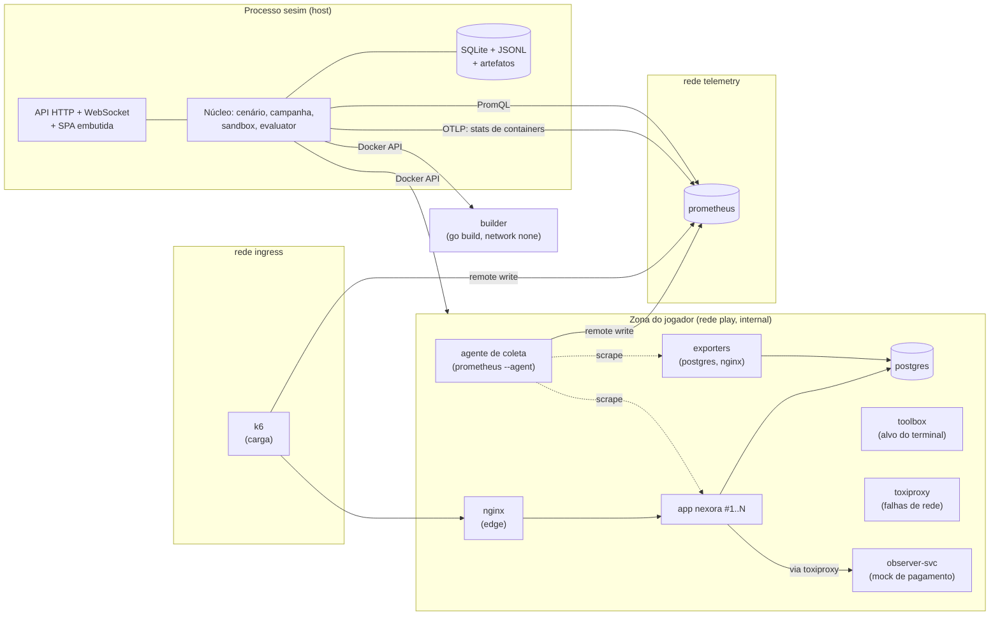
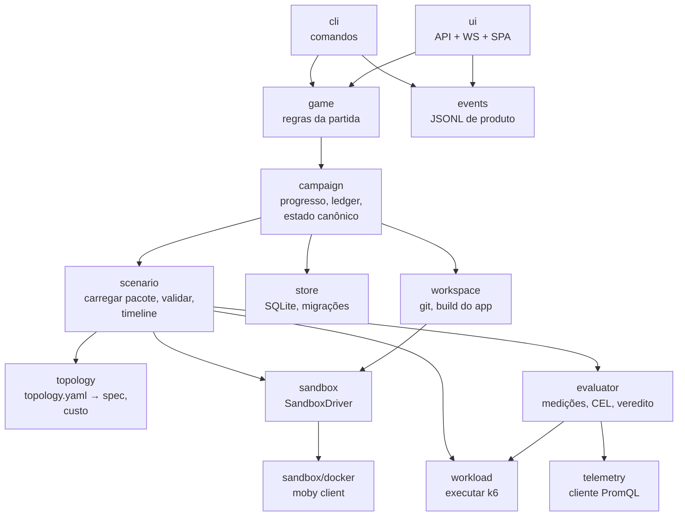
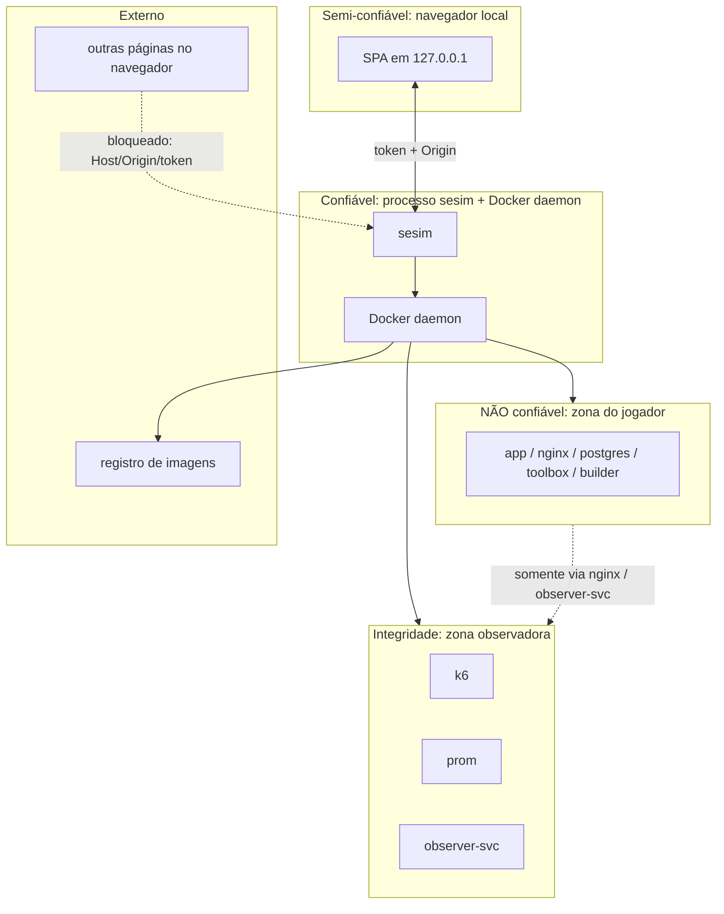
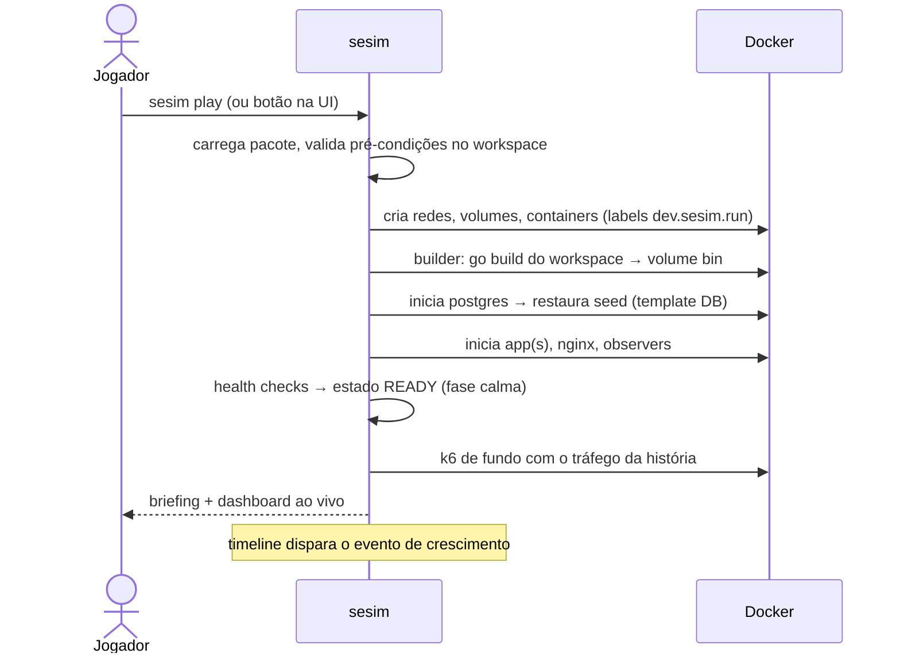
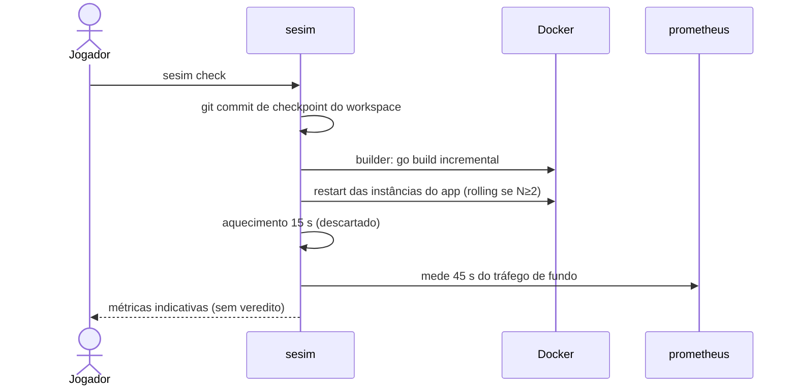

# Arquitetura — Visão Geral

> Status: Chunk 1, proposta. Decisões em `docs/adr/`. Nada foi implementado nem medido ainda.

## Índice

1. [Forças que moldam a arquitetura](#1-forças-que-moldam-a-arquitetura)
2. [C4 nível 1 — Contexto](#2-c4-nível-1--contexto)
3. [C4 nível 2 — Containers](#3-c4-nível-2--containers)
4. [C4 nível 3 — Componentes do `sesim`](#4-c4-nível-3--componentes-do-sesim)
5. [Fronteiras de confiança](#5-fronteiras-de-confiança)
6. [Fluxos principais](#6-fluxos-principais)
7. [Layout do repositório](#7-layout-do-repositório)
8. [Stack resumida](#8-stack-resumida)
9. [O que o brief pedia e foi simplificado](#9-o-que-o-brief-pedia-e-foi-simplificado)

Documentos relacionados: [`sandbox.md`](sandbox.md) · [`simulation-engine.md`](simulation-engine.md) · [`evaluator.md`](evaluator.md) · [`data-model.md`](data-model.md) · [`observability.md`](observability.md) · [`../security/threat-model.md`](../security/threat-model.md)

## 1. Forças que moldam a arquitetura

| Força | Consequência arquitetural |
|---|---|
| Local-first, sem servidor (ADR-0002) | Um binário único contém CLI, API, UI e orquestração. Nenhum serviço remoto é obrigatório. |
| Medição confiável é a promessa central | Separação física entre a **zona do jogador** e a **zona observadora** (ADR-0013). O evaluator nunca confia em números vindos do app avaliado. |
| Iteração < 90 s | Build incremental do app em container com cache; troca de binário sem reconstruir imagem; reset rápido via template database. |
| Modo hospedado futuro | Toda orquestração passa por uma interface `SandboxDriver`. Nenhum código fora de `internal/sandbox/docker` importa o SDK Docker. |
| Conteúdo é o gargalo | Cenário é um pacote declarativo validado por schema, com um harness que testa o cenário automaticamente (ADR-0010). |
| Código fechado (ADR-0009) | Componentes AGPL (k6) rodam como processos/containers separados e não modificados, nunca linkados ao binário. |

## 2. C4 nível 1 — Contexto



Não há serviço remoto da plataforma no MVP. As únicas saídas de rede são o pull de imagens (feito pelo Docker) e, opcionalmente, a verificação de nova versão.

## 3. C4 nível 2 — Containers

"Container" aqui é no sentido C4 (unidade executável). Quase todos também são containers Docker.



Pontos de ligação entre as redes, todos intencionais e mínimos (ADR-0013, refinado pelo ADR-0014):

- `nginx`: `play` + `ingress`. É a porta de entrada do tráfego do k6 e **não** está na `telemetry`, porque a configuração dele é do jogador.
- `k6`: `ingress` + `telemetry`. Gera carga e envia as próprias métricas.
- Agente de coleta: `play` + `telemetry`. É imagem nossa, faz scrape na `play` e só escreve no Prometheus.
- O `observer-svc` conta as cobranças por `order_ref` (evaluator, integridade). O evaluator lê esses registros por fora da `play`, via host (Chunk 6).
- `postgres_exporter` e o *probe* SQL do evaluator acessam o Postgres com um papel **somente leitura** criado pela plataforma.
- As stats de containers vêm do host (Docker API). Nenhum container recebe o socket.

Detalhes de redes, limites e ciclo de vida em [`sandbox.md`](sandbox.md).

## 4. C4 nível 3 — Componentes do `sesim`



| Componente | Responsabilidade | Não faz |
|---|---|---|
| `cli` | `sesim doctor`, `play`, `status`, `check`, `test`, `reset`, `shell`, `down`, `gc` | Lógica de negócio |
| `ui` | NexoraOS: API local com token, terminal por WebSocket, SPA embutida (implementado no Chunk 9; ADR-0016) | Regra de jogo; acesso direto ao Docker |
| `game` | Uma partida: sessão no workspace, sandbox, fases, Quick Check, Production Test, dicas, eventos (Chunk 9) | Apresentar (a CLI e a UI apresentam) |
| `campaign` | Estado da campanha, tentativas, ledger, adoção de estado canônico | Executar cenário |
| `scenario` | Carrega e valida pacotes, conduz a máquina de estados e a timeline do cenário | Medir |
| `topology` | Valida `topology.yaml` contra o catálogo, gera a spec da sandbox, calcula custo modelado e o grafo de arquitetura | Falar com o Docker |
| `sandbox` | Interface `SandboxDriver` + implementação Docker | Conhecer cenários |
| `workspace` | Inicializa o repo do jogador, faz commits de checkpoint e dispara o build no container `builder` | — |
| `workload` | Monta e roda o k6 com perfil, taxa e seed; coleta o resumo | Avaliar |
| `telemetry` | Consultas PromQL com janela de tempo | Guardar histórico longo |
| `evaluator` | Medições → objetivos (CEL) → veredito por dimensão → relatório | Confiar em métricas do app |
| `store` | SQLite (ADR-0012) | — |
| `events` | Eventos de produto em JSONL | Enviar para a rede |

## 5. Fronteiras de confiança



| Fronteira | Protege | Mecanismo principal |
|---|---|---|
| B1 navegador ↔ sesim | Controle do Docker a partir de páginas maliciosas (CSRF, DNS rebinding) | Bind em `127.0.0.1`, token por sessão, validação de `Host` e `Origin` |
| B2 sesim ↔ Docker daemon | O host (acesso ao socket = root) | Socket nunca montado em container; sesim é o único cliente |
| B3 jogador ↔ observadora | Integridade da avaliação | Redes separadas; medição no cliente (k6) e no observer-svc; Postgres acessado com papel somente leitura |
| B4 sandbox ↔ host | O host e a LAN | Sem privilégio, `cap_drop: ALL`, `no-new-privileges`, limites de cgroup, redes `internal` |
| B5 pacotes de cenário ↔ sesim | O motor | MVP: só pacotes oficiais embutidos no binário |

Análise completa: [`../security/threat-model.md`](../security/threat-model.md).

## 6. Fluxos principais

### 6.1 Iniciar cenário



### 6.2 Quick Check (iteração)



### 6.3 Production Test

Detalhado em [`evaluator.md`](evaluator.md). Resumo: pausa o tráfego de fundo → preflight → N execuções controladas do k6 com a timeline de falhas → coleta → oráculo + integridade → veredito por dimensão → relatório salvo → retoma o tráfego de fundo.

## 7. Layout do repositório

Proposta para o Chunk 2. Os limites espelham o brief §39 (plataforma, SDK de cenário, cenários oficiais, infraestrutura) mesmo sem abrir o código.

```text
.
├── cmd/sesim/                 # main
├── internal/
│   ├── cli/
│   ├── game/                  # regras de uma partida (CLI e UI usam)
│   ├── ui/                    # NexoraOS: API, WS, SPA de web/dist
│   ├── campaign/
│   ├── scenario/              # pacote, schema, timeline
│   ├── topology/              # catálogo, validação, custo, grafo
│   ├── sandbox/               # interface SandboxDriver
│   │   └── docker/            # única importação de moby/moby/client
│   ├── workspace/
│   ├── workload/              # k6
│   ├── telemetry/             # PromQL
│   ├── evaluator/             # CEL, estatística, relatório
│   ├── store/                 # SQLite + migrações
│   └── events/
├── web/                       # SPA React + Vite (ADR-0011, 0016); web/embed.go embute web/dist
├── nexora/                    # app demo: módulo Go separado, template do workspace
├── scenarios/                 # pacotes oficiais (embutidos via embed.FS)
│   └── stage1/{c1-slow-search,c2-connection-pressure,c3-instance-failure}/
├── images/                    # Dockerfiles: toolbox, builder, runtime, observer-svc
├── schemas/                   # JSON Schema de scenario.yaml e topology.yaml
└── docs/
```

O `nexora/` é um módulo Go separado, com `vendor/` commitado. O workspace do jogador é uma cópia dele e compila offline.

## 8. Stack resumida

| Camada | Escolha | ADR |
|---|---|---|
| Plataforma | Go, stdlib `net/http` (roteamento com padrões), `log/slog` | 0003 |
| App demo | Go, `net/http` + `pgx/v5` (`pgxpool`), SQL explícito, sem ORM | 0004 |
| Orquestração | Docker Engine API via `github.com/moby/moby/client`, atrás de `SandboxDriver` | 0005 |
| Carga | k6 (imagem oficial, não modificada) com executores arrival-rate | 0006 |
| Métricas | Prometheus + postgres_exporter + nginx exporter + cAdvisor ou stats do Docker | 0007 |
| Terminal | xterm.js (`@xterm/xterm`, `@xterm/addon-fit`) + WebSocket (`github.com/coder/websocket`) + `docker exec` com TTY | 0008 |
| Cenários/objetivos | YAML + JSON Schema + CEL (`cel-go`) | 0010 |
| Frontend | React + Vite + TypeScript; React Flow + ELK.js; uPlot | 0011 |
| Persistência | SQLite (`modernc.org/sqlite`, sem cgo) + JSONL + arquivos | 0012 |
| Falhas | Toxiproxy (rede app↔dependência), `docker kill/pause`, `docker update` (CPU/mem ao vivo), `tc netem` (futuro) | 0005 / `simulation-engine.md` |
| Cache no catálogo | Valkey (BSD-3) em vez de Redis 8 (tri-licença RSAL/SSPL/AGPL) | 0009 |

As versões exatas serão fixadas no Chunk 2 pelo lockfile, conferindo com a documentação oficial (context7).

## 9. O que o brief pedia e foi simplificado

| Brief | Aqui | Motivo |
|---|---|---|
| Platform API → Scenario Orchestrator → Sandbox Manager como serviços | Pacotes Go dentro de um processo | Local-first; serviços separados seriam complexidade sem usuário. A interface `SandboxDriver` preserva o ponto de corte para o modo hospedado. |
| Growth / Failure / Security / Business Engines separados | Um **runner de timeline** com tipos de evento (`traffic`, `fault`, `resource`, `message`, `trigger`) | Os quatro "engines" são tipos de evento sobre o mesmo relógio. Separar agora é abstração prematura. |
| Editor de código web | Editor do jogador | ADR-0002 |
| Visualização de arquitetura derivada do ambiente real | Derivada do `topology.yaml` validado + estado dos containers | É a fonte da verdade do que roda |
