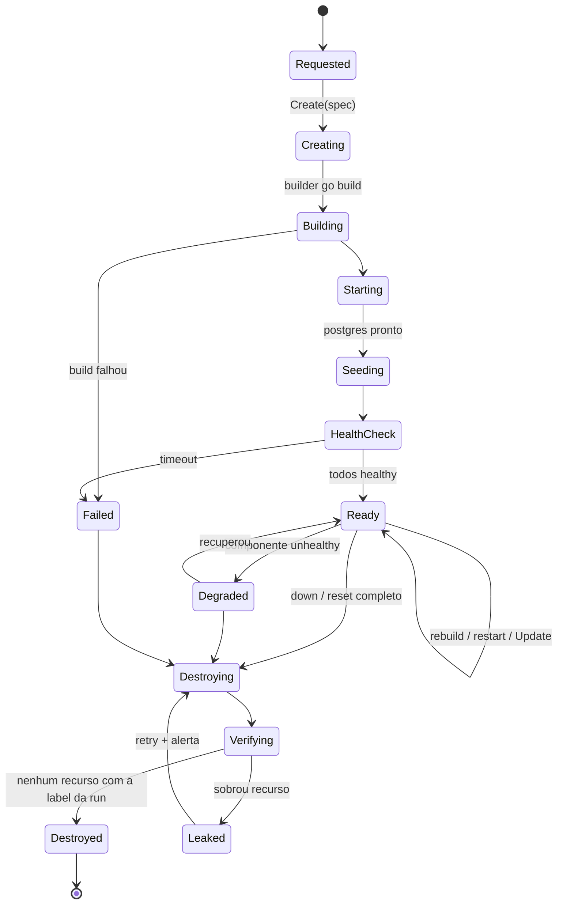
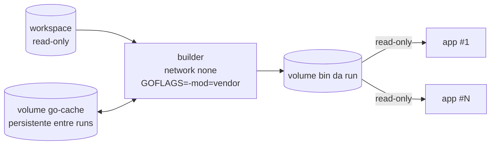

# Sandbox

> Status: Chunk 1, proposta. Decisões: ADR-0005 (driver), ADR-0013 (zonas). Threat model: `../security/threat-model.md`.

## 1. Objetivos

1. Subir, observar e destruir de forma programática o ambiente de um cenário.
2. Isolar a máquina do jogador (e a LAN dele) do que roda dentro da sandbox.
3. Isolar a **medição** do que o jogador controla.
4. Tornar os recursos **o botão da física escalada**: limites rígidos e conhecidos.
5. Resetar em segundos, não minutos.
6. Nunca deixar lixo para trás. A limpeza é verificada, não presumida.

## 2. Composição

Uma *run* de sandbox tem id `r-<ulid>`. Todo recurso Docker leva as labels:

| Label | Valor |
|---|---|
| `dev.sesim.managed` | `true` |
| `dev.sesim.run` | `r-<ulid>` |
| `dev.sesim.zone` | `play` · `obs` · `build` |
| `dev.sesim.component` | `nginx`, `app`, `postgres`, … |
| `dev.sesim.scenario` | `stage1/c1-slow-search@1.0.0` |

### Redes

| Rede | `internal` | Membros |
|---|---|---|
| `sesim-<run>-play` | sim | nginx, app×N, postgres, toolbox, toxiproxy, observer-svc*, exporter* |
| `sesim-<run>-obs` | sim | k6, prometheus, observer-svc, exporters, nginx* |

\* Membro das duas redes. Com `internal: true` não há rota default nem acesso a outras redes, mas **o IP do gateway (o host) continua alcançável** e o host alcança os IPs dos containers ([docs Docker](https://docs.docker.com/reference/cli/docker/network/create/)). Tratado no threat model como risco residual.

Portas publicadas no host: **nenhuma** por padrão. O sesim fala com os containers pelo IP deles na bridge (Linux) ou por um port-forward em `127.0.0.1` (Docker Desktop, onde a bridge não é roteável a partir do host). Isso vai para o `SandboxDriver` como capacidade `Endpoint(component, port)`.

### Containers e limites (valores iniciais, a medir no Chunk 3–5)

| Componente | Zona | CPU | Memória | pids | Rootfs | Notas |
|---|---|---|---|---|---|---|
| nginx | play/obs | 0,5 | 64 MB | 128 | read-only + tmpfs | config do workspace, montada read-only |
| app (cada) | play | 0,5 | 128 MB | 256 | read-only | binário do volume `bin` (read-only) |
| postgres | play | **0,25–1,0** | 256–512 MB | 256 | rw (volume) | limite = botão principal da física escalada |
| toolbox | play | 0,5 | 128 MB | 256 | rw tmpfs | alvo do terminal; usuário não-root |
| toxiproxy | play | 0,25 | 32 MB | 64 | read-only | controlado pelo sesim |
| builder | build | 2,0 | 1 GB | 512 | rw | `--network none`; cache Go em volume; efêmero |
| k6 | obs | 1,0 | 256 MB | 512 | read-only | |
| prometheus | obs | 0,5 | 256 MB | 128 | rw (volume da run) | retenção = duração da run |
| observer-svc | obs/play | 0,25 | 64 MB | 64 | read-only | mock de pagamento + recorder |
| exporters | obs/play | 0,1 | 32 MB | 32 | read-only | |

Orçamento-alvo da sandbox inteira: **≤ 3 GB de RAM, ≤ 4 cores**. Regra de calibração: a soma das quotas de CPU da zona do jogador somada à do k6 deve ser ≤ `cores_do_host − 1`. Se não for, `sesim doctor` recusa ou reduz o perfil de carga.

### Hardening comum (todos os containers)

- `privileged: false`, `cap_drop: [ALL]` e só as capabilities estritamente necessárias por imagem (ex.: nenhuma para o app).
- `security_opt: no-new-privileges:true`; seccomp padrão do Docker.
- Usuário não-root nas imagens próprias (app, toolbox, observer-svc, builder).
- Sem bind mount do host, exceto os **read-only** do workspace necessários (config do nginx, build context no builder).
- Socket Docker **nunca** montado.
- `pids_limit`, `memory` e `nano_cpus` sempre definidos; `ulimits.nofile` definido.
- Imagens por **digest**, não por tag.

## 3. Interface `SandboxDriver`

Esboço de contrato (Go). A implementação fica para o Chunk 8; o formato exato pode mudar.

```go
type SandboxDriver interface {
    Create(ctx context.Context, spec Spec) (RunID, error)          // redes, volumes, containers (não iniciados)
    Start(ctx context.Context, run RunID, components ...string) error
    Stop(ctx context.Context, run RunID, components ...string) error
    Kill(ctx context.Context, run RunID, component string, replica int) error // injeção de falha
    Update(ctx context.Context, run RunID, component string, r Resources) error // física escalada ao vivo
    Exec(ctx context.Context, run RunID, component string, cmd []string, tty bool) (Session, error)
    Health(ctx context.Context, run RunID) (map[string]HealthState, error)
    Stats(ctx context.Context, run RunID) (map[string]ResourceStats, error)
    Endpoint(ctx context.Context, run RunID, component string, port int) (netip.AddrPort, error)
    Snapshot(ctx context.Context, run RunID, volume string) (SnapshotID, error)
    Restore(ctx context.Context, run RunID, volume string, snap SnapshotID) error
    Destroy(ctx context.Context, run RunID) error
    List(ctx context.Context) ([]RunID, error)                       // tudo com dev.sesim.managed=true
}
```

Regras:

- Nenhum pacote fora de `internal/sandbox/docker` importa `github.com/moby/moby/client`.
- Todas as operações são idempotentes (`Destroy` de uma run inexistente não é erro).
- `Spec` é gerada pelo pacote `topology` e é serializável, porque faz parte da tupla de reprodutibilidade.

## 4. Ciclo de vida



- `Failed` sempre mostra a causa ao jogador (log do build, health check que falhou), porque "é o jogo ou sou eu?" precisa de resposta.
- `Degraded` é *estado de jogo* legítimo (o jogador pode ter derrubado algo). Não dispara destruição.

### Limpeza e coleta de lixo

- `Destroy` remove containers, redes, volumes da run e artefatos temporários; depois `Verifying` lista por label.
- Na inicialização, `sesim` roda o **GC**: qualquer run com `dev.sesim.managed=true` que não esteja ativa no SQLite é destruída. Isso cobre crash, `kill -9` e reboot.
- `sesim gc --all` é o botão de pânico.
- **Teste obrigatório (Chunk 8):** create → health → exec → destroy → verify-cleanup = zero recursos; também com kill do processo sesim no meio.

## 5. Build do código do jogador



- O build roda **sem rede**. As dependências vêm de `vendor/` no workspace.
- Adicionar dependência exige `go mod vendor` no host (rede do host, ação do jogador). Limitação documentada; revisitar se atrapalhar.
- A imagem de runtime do app é fixa (base mínima + usuário não-root). Só o binário muda, e o restart leva segundos.
- Com N ≥ 2 instâncias, o restart é *rolling* (uma por vez, esperando health). Isso permite que o C3 ensine deploy sem downtime depois.

## 6. Reset em dois níveis

| Nível | Quando | Como | Custo esperado |
|---|---|---|---|
| **Reset de dados** | Jogador estragou dados ou índices; início de cada Production Test | O banco `nexora_seed` é *template* e pertence ao papel admin. `DROP DATABASE nexora; CREATE DATABASE nexora TEMPLATE nexora_seed OWNER nexora;` | segundos (a medir) |
| **Reset completo** | Configuração do cluster mudou (ex.: `max_connections`), sandbox corrompida | Destroy + Create; volume do Postgres restaurado de um snapshot (tar) gerado depois do primeiro seed e guardado em cache por `(versão do cenário, seed)` | dezenas de segundos (a medir) |

Papéis do Postgres:

| Papel | Uso | Privilégios |
|---|---|---|
| `postgres` (admin) | Só a plataforma | superuser; senha aleatória por run, nunca mostrada |
| `nexora` | App e jogador (psql no toolbox) | dono do banco `nexora`; **não** superuser. Pode `CREATE INDEX` e `CREATE EXTENSION` de extensões *trusted* como `pg_trgm` |
| `sesim_observer` | postgres_exporter e probe do evaluator | `pg_monitor` + `SELECT` nas tabelas de verificação |

Dar superuser ao `nexora` é uma decisão que o jogador pode tomar (via SQL como admin, se descobrir a senha num cenário de segurança futuro). Nesse caso ela vira um fato no ledger (`db.app_user.superuser`).

## 7. Física escalada e calibração

- Cada cenário declara `scale`: o fator narrativo (ex.: 1 VU ≈ 525 usuários) e os limites de recursos que definem o "tamanho" da infraestrutura.
- `sesim doctor` e o preflight do Production Test fazem a **calibração**:
  1. cores e memória disponíveis ao Docker (`docker info`);
  2. microbenchmark de CPU num container com quota fixa: verifica se a quota é de fato entregue (host sobrecarregado = quota não atingida);
  3. capacidade do gerador: um k6 curto contra um endpoint estático do observer-svc confirma que a taxa do perfil é sustentável (`dropped_iterations == 0`) antes de culpar o sistema do jogador.
### Primeiras medições (Chunk 3, 2026-09-25)

Máquina de desenvolvimento: Linux, Docker 29.7.2, cgroup v2, 12 CPUs. Stack de `deploy/dev/compose.yml` com `PG_CPUS=0.25`, sem carga. Medições pontuais, não benchmark.

| O quê | Valor |
|---|---|
| Seed completo (5k usuários, 100k produtos, 20k pedidos) a 1 CPU | 13,7 s |
| `just dev-up` a frio (build das imagens + seed) | 88 s |
| `just dev-determinism` (2× reset + seed) | 106 s; hash igual nas duas execuções e no primeiro `dev-up` |
| Tabela `products` | 26 MB; busca `lamp` casa 2.183 linhas; plano = Seq Scan + top-N heapsort, tudo em `shared hit` |
| `EXPLAIN ANALYZE` da busca (5×) | 57, 409, 62, 125, 118 ms |
| `GET /search?q=lamp` via nginx (5×) | 0,29–0,69 s |
| `GET /products/42` via nginx (3×) | 1–2 ms |

**Achado:** com quota de 0,25 CPU (25 ms a cada período de 100 ms do CFS), uma query que precisa de ~15–60 ms de CPU atravessa vários períodos, e a latência vira uma função de *onde* ela cai no ciclo de throttling. A dispersão (57–409 ms para a mesma query) é ruído que o evaluator precisa absorver (`evaluator.md` §4). Candidatos a investigar no Chunk 4–6: `cpu.cfs_period_us` menor (via `--cpu-period`), `cpuset` dedicado em vez de quota, ou limiares calibrados sobre a distribuição e não sobre execuções isoladas.

- A calibração **não** substitui a folga dos limiares: cada cenário é autorado com ≥5× de distância entre quebrado e corrigido (ver `evaluator.md`).
- O resultado da calibração entra no relatório e na tupla de reprodutibilidade.

## 8. Evolução

| Etapa | Mudança | Impacto no código |
|---|---|---|
| Hardening local | Runtime `runsc` (gVisor) quando disponível | Opção no `Spec`; sem mudança de interface |
| Hospedado v1 | Driver que cria uma microVM (Kata/Firecracker) por jogador, com Docker dentro | Nova implementação de `SandboxDriver`; o `Endpoint` passa a devolver endereços remotos; o terminal ganha proxy autenticado |
| Hospedado em escala | Scheduler sobre várias máquinas (referência: motor de playgrounds do iximiuz Labs) | Fora do escopo desta arquitetura |
