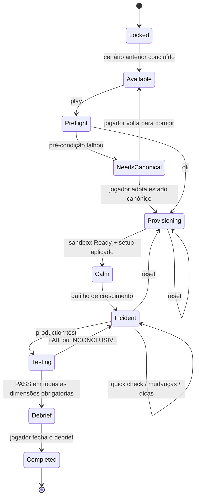
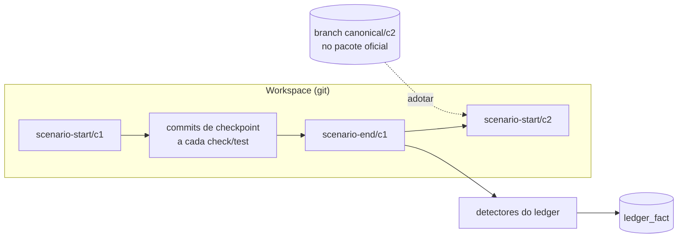

# Simulation Engine — Cenários, Timeline e Campanha

> Status: Chunk 1, proposta; parcialmente implementado no Chunk 6. Formato: ADR-0010, objetivos pelo ADR-0015. O formato v0 **não é estável** e vai mudar depois do Playtest #1.
>
> **Implementado (Chunk 6):** `internal/scenario` lê `metadata`, `dataset`, `test`, `oracle`, `objectives`, `broken` e `references` (exemplo real: `scenarios/stage1/c1-slow-search/scenario.yaml`). O harness é `sesim scenario verify`. **Ainda não implementados:** `timeline`, `scale`, `requires`, `ledger`, `measurements` configuráveis. O esboço do §2 é o alvo, não o estado atual.

## 1. Por que um runner de timeline e não "engines"

O brief propõe Growth, Failure, Security e Business Engines. No MVP, todos se reduzem a **eventos agendados sobre um relógio de cenário**:

| "Engine" do brief | Tipo de evento aqui |
|---|---|
| Growth | `traffic` (perfil, taxa, rampa) |
| Failure | `fault` (kill, pause, latência, perda, CPU/mem) |
| Security | `trigger` condicionado ao ledger (MVP: só semeado, sem disparo) |
| Business | `message` (chat, pager) e `objective_change` (novo SLA, novo orçamento) |

Se um tipo crescer (ex.: Growth com modelo de comportamento de usuário), ele vira um pacote próprio. A decisão é adiada até existir um segundo caso real.

## 2. Pacote de cenário (v0)

```text
scenarios/stage1/c1-slow-search/
├── scenario.yaml          # manifesto (validado por schemas/scenario.schema.json)
├── briefing.md            # o que o jogador vê (só sintomas)
├── debrief.md             # conceito, ressalvas de escala, leitura adicional
├── hints.yaml             # escada de 5 níveis
├── workload/
│   ├── background.js      # tráfego de fundo da história (k6)
│   └── flash-sale.js      # perfil do Production Test (k6)
├── oracle/
│   └── cases.yaml         # entradas + resultado esperado (ou consulta de referência)
├── setup/
│   └── 010-degrade.sql    # como o sistema chega quebrado (aplicado sobre o estado herdado)
└── references/            # soluções de referência como patches git sobre o início do cenário
    ├── a-trigram.patch
    ├── b-fulltext.patch
    ├── c-prefix.patch     # esperado: FAIL em corretude
    └── d-naive-cache.patch
```

Esboço de `scenario.yaml`:

```yaml
apiVersion: sesim.dev/v0alpha1
kind: Scenario
metadata:
  id: stage1/c1-slow-search
  version: 1.0.0
  title: "Slow Search"
requires:                      # pré-condições sobre o workspace herdado (CEL sobre fatos detectados)
  - "workspace.builds"
  - "api.contract_version == 1"
scale:
  narrativeUsersPerVU: 525
  resources:
    postgres: { cpus: 0.25, memoryMB: 256 }
    app:      { cpus: 0.5,  memoryMB: 128, replicas: 1 }
timeline:                      # tempo relativo ao início (fase calma incluída)
  - at: 0s
    message: { channel: founder, file: briefing.md#calm }
  - at: 0s
    traffic: { script: workload/background.js, rate: 5/s }
  - on: "player.completed_onboarding || elapsed > 5m"
    traffic: { script: workload/background.js, rate: 200/s, rampUp: 30s }
    message: { channel: founder, file: briefing.md#growth }
tests:
  quick:      { window: 45s, warmup: 15s }
  production:
    script: workload/flash-sale.js
    rate: 200/s
    duration: 3m
    warmup: 30s
    runs: 3
    seed: 4242
measurements:                  # nomes estáveis que os objetivos usam
  p95_ms:        { source: k6, metric: http_req_duration, stat: p95, filter: "name == 'search'" }
  error_rate:    { source: k6, metric: http_req_failed, stat: rate }
  db_cpu:        { source: container, component: postgres, metric: cpu_of_quota, stat: p90 }  # uso / quota, 0..1
  correctness:   { source: oracle, cases: oracle/cases.yaml }
objectives:
  - id: search-correct
    dimension: correctness
    expr: "correctness.pass_ratio == 1.0"
  - id: search-latency
    dimension: latency
    expr: "p95_ms < 300"
    margin: 0.15                 # zona de INCONCLUSIVE em torno do limiar
  - id: errors
    dimension: availability
    expr: "error_rate < 0.005"
  - id: db-headroom
    dimension: resources
    expr: "db_cpu < 0.70"
ledger:                        # detectores que registram fatos ao terminar o cenário
  - key: search.strategy
    detect: { source: sql, query: "select indexdef from pg_indexes where tablename='products'" }
references:
  - { patch: references/a-trigram.patch,    expect: PASS }
  - { patch: references/b-fulltext.patch,   expect: PASS }
  - { patch: references/c-prefix.patch,     expect: { correctness: FAIL } }
  - { patch: references/d-naive-cache.patch, expect: { latency: FAIL } }
```

Os valores (taxas, limiares, recursos) são **ilustrativos** e serão calibrados com medição no Chunk 6.

### Invariantes do formato

- Nenhum objetivo pode referenciar a presença de uma tecnologia. O linter do pacote rejeita `measurements` com `source: topology` em `objectives`. A topologia só pode alimentar **custo** e **complexidade**.
- Todo cenário tem ≥2 referências `PASS` distintas. É o princípio "várias soluções válidas" imposto pelo formato.
- Todo cenário tem o estado quebrado implícito, que precisa dar FAIL em pelo menos uma dimensão.

## 3. Ciclo de vida do cenário



- **Pausar e retomar:** `sesim down` guarda o estado lógico (fase, relógio do cenário, dicas usadas) no SQLite e destrói a sandbox. `sesim play` reconstrói a partir do workspace e retoma na mesma fase. Não congelamos containers (evita estado de host no meio).
- **Reset** volta a `Provisioning` mantendo o workspace (não apaga o código do jogador). Para descartar o código, `sesim reset --hard` faz checkout do commit de início do cenário, com confirmação.

## 4. Campanha, workspace e ledger



- O sesim cria **tags** git `sesim/scenario-start/<id>` e `sesim/scenario-end/<id>`, além de commits de checkpoint automáticos num branch `sesim/checkpoints` (sem sujar o branch de trabalho do jogador).
- **Pré-condições** (`requires`) são avaliadas sobre fatos detectados: o workspace compila, a versão do contrato da API, o número de réplicas na topologia, etc.
- **Estado canônico:** o pacote oficial traz o estado final de referência do cenário anterior. Adotar esse estado cria um commit no workspace com o diff visível e registra `canonical_state_adopted` no ledger.
- **Gatilhos tardios** (post-MVP): eventos `trigger` com condição CEL sobre o ledger, por exemplo `ledger.has("backup.disabled")`.

## 5. Tráfego

- **Fundo:** k6 de longa duração, em taxa constante, com o tráfego "atual da história". Alimenta o dashboard ao vivo e o Quick Check. Muda de taxa por eventos da timeline, o que implica reiniciar o k6 com a nova taxa (k6 não muda a taxa de um cenário em execução sem API externa; a verificar no Chunk 4).
- **Production Test:** o fundo pausa; roda o script do teste com modelo **aberto** (`constant-arrival-rate` / `ramping-arrival-rate`). `dropped_iterations > 0` invalida a execução como INCONCLUSIVE, porque o gerador não conseguiu sustentar a taxa ([docs k6](https://grafana.com/docs/k6/latest/using-k6/scenarios/concepts/dropped-iterations/)).
- **Determinismo:** a seed do cenário alimenta a geração dos termos de busca, dos usuários e dos carrinhos no script k6. O que se reproduz é a *sequência de intenções*, não o timing exato. É o limite honesto de "reprodutível".

## 6. Injeção de falhas

| Tipo | Mecanismo | Usado em |
|---|---|---|
| `kill` | `SandboxDriver.Kill` | C3 |
| `pause` | `docker pause` (processo congelado; simula travamento) | futuro |
| `latency` / `timeout` / `reset_peer` | Toxiproxy entre app e observer-svc (pagamento) | C2 |
| `resource` | `SandboxDriver.Update` (CPU/mem ao vivo) | eventos de crescimento, noisy neighbor |
| `netem` | sidecar com `tc netem` (exige `NET_ADMIN` **só no sidecar**) | Stage 5 |

Toda falha é registrada com timestamp no relatório do teste, para aparecer no gráfico e no postmortem.

## 7. Reprodutibilidade

Tupla registrada em todo teste:

```text
(scenario.id, scenario.version, seed, workspace.commit, topology.hash,
 image.digests[], sesim.version, calibration{cores, quota_delivered, os, arch})
```

Com a tupla e o workspace, `sesim replay <test-id>` reconstrói o ambiente. O resultado é *aproximadamente* igual, dentro da dispersão medida.

## 8. Harness de cenário (para autoria)

`sesim scenario verify <pacote>`:

1. valida o schema e o linter (invariantes do §2);
2. aplica o estado quebrado → Production Test → espera FAIL;
3. para cada referência: aplica o patch → Production Test → confere o `expect`;
4. repete tudo K vezes e reporta a **taxa de inversão**, que é a H5 (`mvp.md`).

Roda no CI em cada mudança de cenário ou da plataforma. É a principal defesa contra o risco de "custo de autoria de conteúdo".
