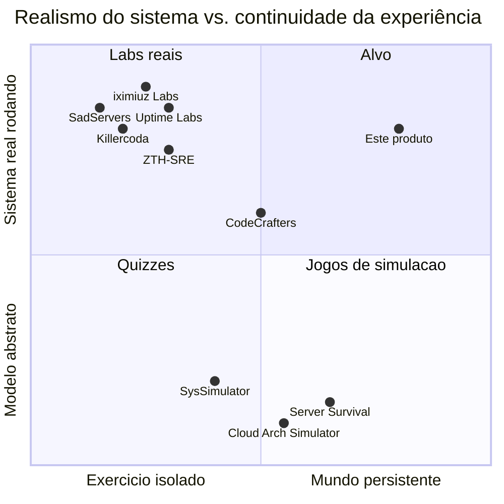

# Panorama Competitivo

> Pesquisado em 2026-09-24 por busca web. As descrições vêm do site ou README de cada produto, salvo indicação. Nenhum número de uso ou receita é afirmado porque nenhum foi verificado de forma independente. Reverificar antes de qualquer afirmação pública.

## Concorrentes mais próximos

| Produto | O que é | Sobreposição | Lacuna em relação a nós |
|---|---|---|---|
| **Uptime Labs** | SaaS B2B, "flight simulator" de resposta a incidentes: o time depura ambientes quebrados com logs, métricas e terminais reais, com coaching por IA. | Incidentes realistas em ambiente real. | Vende para times, não para quem aprende sozinho. Só incidentes: não há construção nem evolução do sistema. Sem campanha. |
| **ZTH-SRE** (open source, MIT) | Lab SRE self-hosted: servidor Go + UI React, tráfego k6, Prometheus, terminal em container toolbox, 13 exercícios de incidente. | Forma *técnica* quase idêntica ao nosso MVP (compose, k6, Prometheus, terminal web). | O jogador não edita código; a avaliação é autoverificação guiada, não automática; não há progressão. Projeto muito inicial (≈0 stars, ~10 commits na data da pesquisa). Serve de validação da arquitetura e de alerta: **a tecnologia não é o diferencial**. |
| **YouBrokeProd** (comunidade) | Simulador gamificado de incidentes no navegador. | Incidentes gamificados. | Aparentemente simulado, sem sistema real. Projeto pequeno, não avaliado a fundo. |

## Labs práticos / troubleshooting

| Produto | Modelo | Lacuna |
|---|---|---|
| **SadServers** | Servidores Linux reais e efêmeros, shell no navegador, cenário com verificação automática (estilo CTF). Também usado em contratação. | Quebra-cabeças isolados, pass/fail binário, sem carga, sem mudança de código, sem continuidade. É o mais próximo em *espírito* de "sistema real + verificação automática". |
| **iximiuz Labs** | Motor de playgrounds em microVMs Firecracker; tutoriais, desafios e cursos de containers, K8s e redes. | Foco em infra e containers; desafios são tarefas verificadas, não performance sob carga. **Referência principal para o futuro modo hospedado.** |
| **Killercoda** | Terminal no navegador + VMs pré-configuradas ou clusters K8s pequenos. | Estilo tutorial: seguir passos. |
| **KodeKloud** | Cursos + labs de ferramentas DevOps. | Currículo por ferramenta, o oposto de "sintoma primeiro". |
| **Instruqt** | Plataforma B2B para montar labs, sem conteúdo próprio. | Construtor, sem pedagogia. |

## Simuladores abstratos de system design / jogos

| Produto | Modelo | Lacuna |
|---|---|---|
| **SysSimulator** | Navegador; motor de eventos discretos em Rust→WASM; blueprints, cenários de caos, custo AWS. | Componentes são modelos abstratos de capacidade. Não dá para escrever uma query ruim. |
| **Cloud Arch Simulator** (Steam) | "Tower defense reverso": posicionar CDN, cache, LB e DB para sobreviver a picos; nota por SLA, orçamento e organização. | Ótima referência de *game feel*, zero engenharia real. |
| **Server Survival** (open source) | Tower defense 3D; orçamento, reputação e saúde; campanha de 25 níveis em 5 capítulos. | Abstrato. A estrutura de campanha por capítulos, sozinha, não é novidade. |
| **SystemForge / repos "system-design-simulator"** | Arrastar e soltar arquitetura, tráfego simulado, nota multidimensional para entrevista. | Preparação para entrevista, abstrato. |

**Conclusão:** nota multidimensional (SLA + custo + organização) já existe *em simuladores abstratos*. Nosso diferencial é "os mesmos trade-offs, **medidos num sistema real que você modificou**", não "nota multidimensional".

## Práticas (não produtos)

- **Wheel of Misfortune** (prática do livro de SRE do Google; ferramenta open source de dastergon): incidentes interpretados com um mestre de jogo humano. Comprova o valor pedagógico de ensaiar incidentes. Nosso modo Incidents pode ser visto como um mestre de jogo automático.
- **Game days / chaos engineering** (Gremlin, Chaos Mesh, Litmus): ferramentas que podemos *usar*, não concorrentes.

## Indiretos

- **Plataformas de código:** LeetCode, HackerRank, Exercism, **CodeCrafters**. O CodeCrafters é o mais próximo em ética: programas reais, harness automático, estágios. Mas ensina a *construir um componente*, não a *operar um sistema sob carga*.
- **CTFs:** HackTheBox, TryHackMe, picoCTF. Comprovam que "máquina vulnerável real + objetivo verificável" engaja. Diferença: objetivo adversarial único, sem sistema contínuo, sem trade-off.

## Mapa de posicionamento

As posições refletem julgamento qualitativo, não dados.

## Implicações

1. **Stack não é fosso.** O diferencial está na qualidade dos cenários, no evaluator e no debrief, ou seja, conteúdo e pedagogia.
2. O **formato de cenário e o harness de teste de cenários** importam cedo, para a *nossa* velocidade de autoria.
3. A moldura "sobreviva ao pico" (Cloud Arch Simulator, Server Survival) engaja. Emprestamos a moldura e mantemos o realismo.
4. **Distribuição fechada e gratuita** (ADR-0009) nos afasta da cultura open source de iximiuz e ZTH-SRE. Compensação: binário fácil de instalar e conteúdo de qualidade. O repositório público de issues e releases fica em aberto.

## Fontes

- SadServers: https://sadservers.com/ · https://github.com/SadServers/sadservers
- iximiuz Labs: https://labs.iximiuz.com/about · https://iximiuz.com/en/posts/iximiuz-labs-story/ · https://iximiuz.com/en/posts/learn-by-doing-platforms/
- Killercoda: https://killercoda.com/ · comparação escrita pela Instruqt: https://instruqt.com/killercoda-comparison
- Uptime Labs (listagem escrita pela própria empresa): https://www.uptimelabs.io/learn/the-best-incident-response-training-providers
- ZTH-SRE: https://github.com/Cesarsk/zth-sre
- YouBrokeProd: https://dev.to/cdnsteve/how-i-turned-my-worst-on-call-nightmare-into-a-browser-game-36fa
- SysSimulator: https://syssimulator.com/
- Cloud Arch Simulator: https://store.steampowered.com/app/4919330/Cloud_Arch_Simulator/
- Server Survival: https://github.com/pshenok/server-survival
- Simuladores de system design: https://github.com/000Sushant/system-design-simulator · https://github.com/vijaygupta18/system-design-simulator
- Wheel of Misfortune: https://github.com/dastergon/wheel-of-misfortune · https://openpracticelibrary.com/practice/wheel-of-misfortune/
