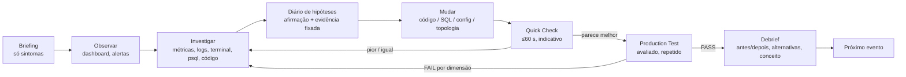
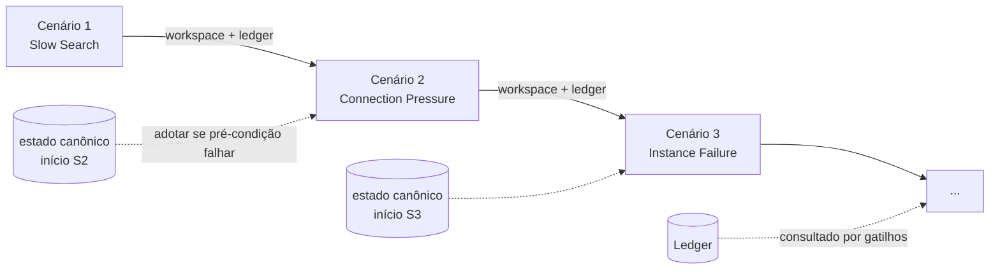

# Game Loop, Progressão e Direção de Design

## 1. Loop central

O loop do brief está certo, mas dois passos não têm mecânica associada: **"formular hipótese"** e **"aprender"**. Se não forem *ações na UI*, só acontecem na cabeça do jogador (ou não acontecem), e não conseguimos medi-los.

| Mecânica | Por quê |
|---|---|
| **Diário de hipóteses** | Um caderno leve do tipo "acho que X porque Y", com métricas ou linhas de log fixadas como evidência. Torna o passo explícito, alimenta o postmortem depois e gera a métrica `time_to_first_hypothesis`. Inspirado no livro de dedução de *Return of the Obra Dinn*. Opcional, nunca bloqueia. |
| **Dois níveis de teste** | A velocidade de iteração decide se o jogo é divertido. Um teste que dá nota precisa ser longo ou repetido para ser estatisticamente honesto, e isso é lento demais para iterar. Por isso há o **Quick Check** (curto, rotulado "indicativo") e o **Production Test** (dá a nota). Meta: da mudança ao resultado em < 90 s, incluindo rebuild. |
| **Debrief** | O passo de consolidação. Mostra o diff do jogador, as métricas antes/depois, onde a solução fica em relação a 2–3 *soluções de referência* (latência, custo, componentes, corretude) e uma explicação curta do conceito. É assim que cumprimos o critério 10 ("outra arquitetura também resolveria") sem depender de dados da comunidade. |

## 2. Primeira experiência (revisada)

O "Production is degraded. Investigate. Nada mais." do brief tem o *tom* certo. Mas, para uma estudante do fim do curso, "nada mais" tende a virar paralisia e abandono.

1. **Fase calma (≤5 min, pulável).** "Bem-vinda ao Mercado Lerdo. Você é a primeira engenheira. 127 usuários. Tudo funciona." É um tour disfarçado de tarefas do CEO: "quantos pedidos tivemos hoje?" (leva ao psql), "qual nosso p95?" (leva ao dashboard), "onde fica o código da busca?" (leva ao workspace). Ela aprende as ferramentas *antes* do estresse.
2. **Evento de crescimento.** Chega uma mensagem do fundador: um criador de conteúdo citou o Mercado Lerdo e o tráfego subiu 40×. O dashboard degrada em tempo real, com carga real e não animação.
3. **O pedido.** "Produção degradada. Investigue." Nada além disso no canal principal.
4. **Rede de segurança.** Um botão discreto e permanente "Perguntar ao sênior" abre a escada de dicas (`mvp.md` §4). No MVP, usá-lo nunca é punido, apenas medido.

## 3. Progressão

### O que progride

Não é XP. São três coisas:

1. **A empresa** (estágio narrativo, usuários, receita, promessas de SLA): a *pressão*.
2. **O sistema** (workspace do jogador, com código e topologia versionados em git): o *artefato*.
3. **O conhecimento do jogador**: a única progressão real. Como em *Outer Wilds*, o jogo não te dá nada além de entendimento, e o sistema que você construiu é a prova disso.

### Estrutura da campanha: cadeia autorada + estado herdado + registro de decisões

- **Cenários são autorados e ordenados.** Cada um declara *pré-condições* sobre o sistema (por exemplo, "a busca retorna resultados corretos" ou "o app roda com ≥2 instâncias").
- **O workspace é herdado.** O cenário N+1 começa do estado final do jogador no cenário N.
- Se o estado viola as pré-condições do próximo cenário, o jogador pode **adotar o estado canônico** (um branch de referência), vendo o diff. Isso mantém a campanha jogável e reproduzível.
- **Registro de decisões (ledger).** Escolhas relevantes viram fatos com tag: `backup.disabled`, `db.app_user.superuser`, `cache.ttl_gt_1h`, `adr:008`. Parte é detectada automaticamente na topologia e na configuração; parte vem dos ADRs do jogador.
- **Consequências tardias são gatilhos autorados** que consultam o ledger. Exemplo: `ledger.has("backup.disabled")` no Stage 4 faz a corrupção de dados doer. Reproduzível, testável, e ainda dá a sensação de que "o mundo lembra".

### Mapa de estágios (revisado)

Segurança e custo são **fios que atravessam os estágios**, não estágios próprios.

| Estágio | Pressão | Performance/capacidade | Disponibilidade | Segurança (semeada) | Custo |
|---|---|---|---|---|---|
| 1 Garagem (MVP) | crescimento ×40 | query lenta, pool esgotado | falha de instância única | segredo no histórico git; parâmetro injetável na busca (dormente) | orçamento fixo |
| 2 PMF | 10k usuários | N+1, downtime de deploy | deploy sem downtime, backups | CVE em dependência | primeira revisão da fatura |
| 3 Viral | "1M" (escalado) | cache, rate limit, réplicas | LB, health checks | bots / credential stuffing | overprovisioning vs. autoscale |
| 4 Distribuído | fluxos assíncronos | filas, consumer lag | idempotência, outbox, retries | SSRF via webhook | complexity budget |
| 5 Global | regiões (latência emulada) | replication lag | failover, RPO/RTO | residência de dados | fatura multi-região |
| 6 Eng. de Produção | plantão | capacity planning | SLOs, error budgets, caos | incidente-ou-ataque? | otimização de custo |

Os estágios 4–5 exigem componentes caros de rodar de verdade. Eles vão usar **geografia emulada** (latência `tc netem` entre grupos de containers) e brokers pequenos. A decisão fica para outro chunk.

## 4. Referências de design (o que roubar, especificamente)

| Jogo / ferramenta | O que roubar | Como aplicar |
|---|---|---|
| **Opus Magnum / SpaceChem** (Zachtronics) | Depois de resolver, histogramas mostram onde sua solução fica em custo, ciclos e área. | Gráfico do debrief: jogador vs. referências em p95, custo mensal e nº de componentes. Depois, vs. todos os jogadores. **É a melhor mecânica para mostrar "várias respostas certas".** |
| **Factorio / Mini Metro** | Gargalos *visíveis* à medida que a rede cresce. | Grafo de arquitetura com fluxo animado de requisições: arestas engrossam com o RPS e nós mudam de cor com a saturação (método USE). |
| **Return of the Obra Dinn / Her Story** | Dedução com evidências; buscar num corpus *é* o jogo. | Diário de hipóteses com evidência fixada; logs como corpus pesquisável. |
| **Outer Wilds** | Conhecimento é a única progressão. | Sem grind de atributos. |
| **Frostpunk / This War of Mine** | Decisões com consequência tardia e visível (o "Livro de Leis"). | Ledger + histórico de ADRs aparecendo quando a consequência chega ("isso vem do ADR-008"). |
| **Kerbal Space Program** | Física quase real; falhar é engraçado e informativo; iteração rápida. | Medições reais, Quick Check rápido, falha explicada em vez de punida. |
| **Papers, Please** | UI procedural e restrita que vira o próprio mundo. | UI diegética: chat da empresa, pager e tickets trazem a história. |
| **Hacknet / Bitburner** | Terminal como interface principal. | Terminal real, não um parser falso de comandos. |
| **Cloud Arch Simulator / Server Survival** | Moldura "sobreviva ao pico" e curva de tensão. | Production Test apresentado como uma corrida de sobrevivência com timeline ao vivo. |
| **Netflix Vizceral / Kiali** (ferramentas) | Visualização de fluxo de tráfego em grafos de serviço. | Linguagem visual da tela de arquitetura. |

## 5. Direção de UI (chunks futuros)

- **Console de operações diegético**, não "hacker de filme". Calmo, denso e legível, mais perto de um Grafana ou Linear bem desenhado do que de verde sobre preto.
- **Três camadas de informação:**
  - *história*: chat, pager, CEO;
  - *sinais*: dashboards, logs, traces;
  - *sistema*: terminal, workspace, topologia.

  A tensão vem dos sinais; a história é curta.
- **Selos de proveniência:** todo número tem um selo `medido`, `modelado` (ex.: custo) ou `narrativo` (ex.: "184.291 usuários" = 350 VUs × fator de escala).
- **Tempo:** relógio real para medições e *tempo virtual da empresa* para a narrativa (um "dia" de Production Test dura 3 min reais). Os dois aparecem sempre.
